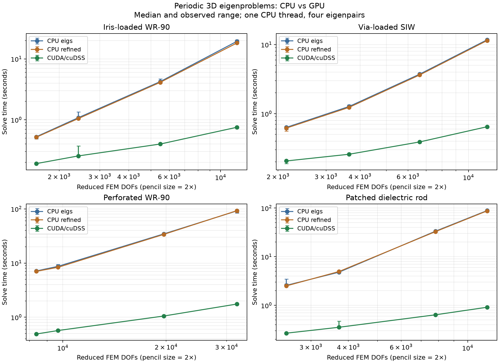
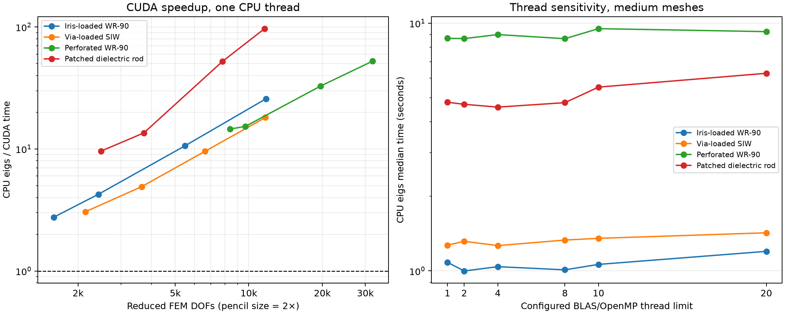
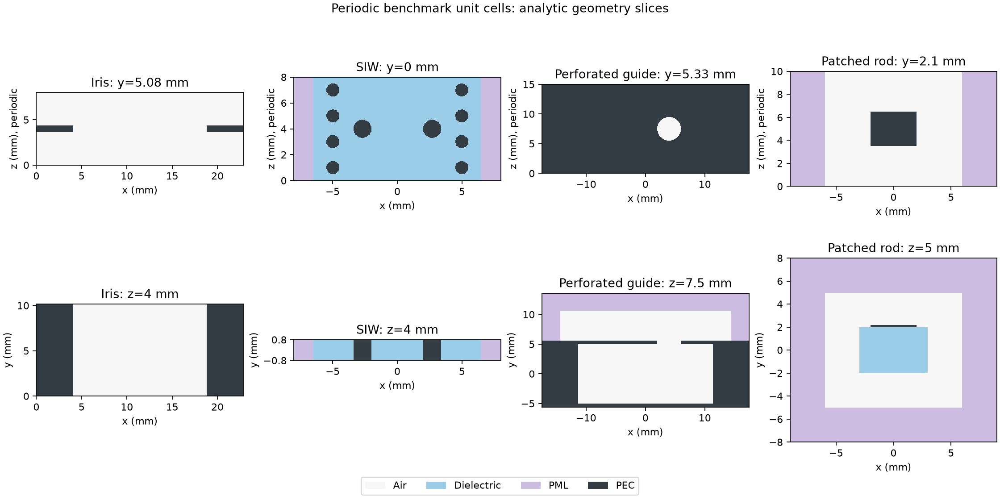

Periodic 3D CPU/GPU benchmark report
====================================

Solver source commit: 9d3dbad3fa1fe5ec269c686c7a7d324cbf5af94e. Four periodic unit-cell geometries.
40 configurations, 120 backend/configuration rows, 360 timed solves.
Validated samples: 360/360. Maximum original-pencil residual: 1.442e-12.
Maximum matched relative eigenvalue-magnitude error: 9.330e-14.

Hardware and software
---------------------

* CPU: Intel(R) Xeon(R) Silver 4210 CPU @ 2.20GHz; 2 sockets, 10 cores/socket, 40 logical CPUs, 2 hardware threads/core.
* CPU maximum reported clock: 3200.0000 MHz; L2: 20 MiB (20 instances); L3: 27.5 MiB (2 instances); NUMA nodes: 2.
* GPU: one NVIDIA TITAN RTX, physical device 3 (logical CUDA device 0 in each benchmark worker). No multi-GPU computation.
* GPU VRAM: 24576 MiB; compute capability 7.5; power limit 280.00 W; PCI bus 00000000:AF:00.0.
* NVIDIA driver: 595.45.04. Reported maximum SM/memory clocks: 2100 MHz / 7001 MHz (supported maxima, not measured sustained clocks).
* OS-visible RAM: 109.28 GiB; CPU affinity allowed 40 logical CPUs. Workers were not pinned to a core or NUMA node.
* OS: Linux-5.14.0-611.36.1.el9_7.x86_64-x86_64-with-glibc2.34.
* CUDA runtime and driver API reported by CuPy: 13.2 / 13.2. Local nvcc toolkit: 13.2.51 (full capture in hardware.json).
* Python: 3.13.12; NumPy 2.5.4; SciPy 1.18.1; CuPy 14.2.0; cuDSS package 0.8.0.10; Cython 3.3.0; Gmsh 4.15.2.
* BLAS (libscipy_openblas64_-f48b354e.so): OpenBLAS 0.3.34.106.0  USE64BITINT DYNAMIC_ARCH NO_AFFINITY SkylakeX MAX_THREADS=64.
* BLAS (libscipy_openblas-5f890258.so): OpenBLAS 0.3.31.dev DYNAMIC_ARCH NO_AFFINITY SkylakeX MAX_THREADS=64.
* CPU thread limits tested: 1, 2, 4, 8, 10, 20. Set before imports using OMP_NUM_THREADS, OPENBLAS_NUM_THREADS, MKL_NUM_THREADS and BLIS_NUM_THREADS. The expanded thread sweep also records OpenBLAS runtime thread getters in each result.
* Arithmetic: complex128 / double precision. CPU eigs uses SciPy ARPACK + SuperLU; CPU refined uses the native Cython implementation; GPU refined uses CuPy + cuDSS.

Measurement method
------------------

Timings are medians of three runs; individual values and ranges are retained in summary.csv and per-case results.json.
Mesh assembly and warmup are excluded. Upload, cuDSS analysis/factorization, iteration, CPU extraction and download are included.
These are warmed-process timings: first-use initialization/JIT compilation is represented in the saved warmups, not the reported medians.
CPU eigs uses ARPACK with SuperLU; CPU refined uses the built Cython kernel. CUDA uses CuPy/cuDSS complex FP64.

Agreement follows the requested one-to-one eigenvalue magnitude criterion, so symmetry-related forward/backward roots are equally valid.
Complex eigenvalues and their original complex-set mismatch are preserved for inspection. All solves must independently meet the residual target 1e-8.

Observed convergence work: cpu_eigs: steps [81, 97]; cpu_refined: steps [80, 96], restarts [0]; cuda_cudss: steps [80, 96], restarts [0].

Mesh/DOF scaling
---------------

.. csv-table::
   :header: "Case", "Mesh mm", "Threads", "FEM DOFs", "Pencil DOFs", "CPU eigs s", "CPU refined s", "CUDA s", "CUDA speedup"

   "iris-coarse", "4.0", "1", "1591", "3182", "0.5257", "0.5166", "0.1905", "2.76x"
   "iris-medium", "3.0", "1", "2422", "4844", "1.0833", "1.0483", "0.2549", "4.25x"
   "iris-fine", "2.0", "1", "5477", "10954", "4.2339", "4.1180", "0.3993", "10.60x"
   "iris-large", "1.4", "1", "11782", "23564", "19.4612", "18.2790", "0.7534", "25.83x"
   "siw-coarse", "2.0", "1", "2145", "4290", "0.6332", "0.6184", "0.2069", "3.06x"
   "siw-medium", "1.4", "1", "3646", "7292", "1.2707", "1.2344", "0.2586", "4.91x"
   "siw-fine", "1.0", "1", "6623", "13246", "3.7332", "3.6350", "0.3899", "9.57x"
   "siw-large", "0.75", "1", "11711", "23422", "11.7262", "11.4420", "0.6471", "18.12x"
   "perforated_waveguide-coarse", "5.0", "1", "8373", "16746", "7.1375", "7.0277", "0.4900", "14.57x"
   "perforated_waveguide-medium", "3.5", "1", "9685", "19370", "8.6922", "8.3431", "0.5677", "15.31x"
   "perforated_waveguide-fine", "2.5", "1", "19680", "39360", "34.4978", "33.7921", "1.0523", "32.78x"
   "perforated_waveguide-large", "2.0", "1", "32161", "64322", "91.9752", "92.7427", "1.7518", "52.50x"
   "dielectric_rod-coarse", "4.0", "1", "2484", "4968", "2.5759", "2.5104", "0.2681", "9.61x"
   "dielectric_rod-medium", "3.0", "1", "3720", "7440", "4.7990", "4.9493", "0.3544", "13.54x"
   "dielectric_rod-fine", "2.0", "1", "7807", "15614", "33.3732", "32.6975", "0.6393", "52.21x"
   "dielectric_rod-large", "1.7", "1", "11609", "23218", "88.5386", "87.2676", "0.9138", "96.89x"

Observed scaling
~~~~~~~~~~~~~~~~

* Iris-loaded WR-90: 1,591 to 11,782 reduced FEM DOFs; GPU speedup 2.76x to 25.83x relative to one-thread CPU eigs.
* Via-loaded SIW: 2,145 to 11,711 reduced FEM DOFs; GPU speedup 3.06x to 18.12x relative to one-thread CPU eigs.
* Perforated WR-90: 8,373 to 32,161 reduced FEM DOFs; GPU speedup 14.57x to 52.50x relative to one-thread CPU eigs.
* Patched dielectric rod: 2,484 to 11,609 reduced FEM DOFs; GPU speedup 9.61x to 96.89x relative to one-thread CPU eigs.

CPU thread sensitivity
----------------------

The same medium mesh is compared at each thread limit. These are configured BLAS/OpenMP limits, not claims of parallel ARPACK iteration.
SciPy's sparse LU build links to OpenBLAS. Increasing the limit can have little benefit or increase overhead; the measurements determine the outcome.

.. csv-table::
   :header: "Case", "Mesh mm", "Threads", "FEM DOFs", "Pencil DOFs", "CPU eigs s", "CPU refined s", "CUDA s", "CUDA speedup"

   "dielectric_rod-medium", "3.0", "1", "3720", "7440", "4.7990", "4.9493", "0.3544", "13.54x"
   "dielectric_rod-medium-threads2", "3.0", "2", "3720", "7440", "4.7073", "4.7437", "0.3582", "13.14x"
   "dielectric_rod-medium-threads4", "3.0", "4", "3720", "7440", "4.5860", "4.8605", "0.3659", "12.53x"
   "dielectric_rod-medium-threads8", "3.0", "8", "3720", "7440", "4.7800", "4.6733", "0.3929", "12.17x"
   "dielectric_rod-medium-threads10", "3.0", "10", "3720", "7440", "5.5228", "4.9600", "0.3887", "14.21x"
   "dielectric_rod-medium-threads20", "3.0", "20", "3720", "7440", "6.2808", "5.1864", "0.4080", "15.40x"
   "iris-medium", "3.0", "1", "2422", "4844", "1.0833", "1.0483", "0.2549", "4.25x"
   "iris-medium-threads2", "3.0", "2", "2422", "4844", "0.9993", "1.0235", "0.2414", "4.14x"
   "iris-medium-threads4", "3.0", "4", "2422", "4844", "1.0402", "1.0644", "0.2471", "4.21x"
   "iris-medium-threads8", "3.0", "8", "2422", "4844", "1.0101", "1.0238", "0.2499", "4.04x"
   "iris-medium-threads10", "3.0", "10", "2422", "4844", "1.0624", "1.0931", "0.2622", "4.05x"
   "iris-medium-threads20", "3.0", "20", "2422", "4844", "1.1995", "1.1395", "0.2913", "4.12x"
   "perforated_waveguide-medium", "3.5", "1", "9685", "19370", "8.6922", "8.3431", "0.5677", "15.31x"
   "perforated_waveguide-medium-threads2", "3.5", "2", "9685", "19370", "8.6725", "8.3312", "0.5895", "14.71x"
   "perforated_waveguide-medium-threads4", "3.5", "4", "9685", "19370", "9.0009", "8.2515", "0.5948", "15.13x"
   "perforated_waveguide-medium-threads8", "3.5", "8", "9685", "19370", "8.6650", "9.3627", "0.5875", "14.75x"
   "perforated_waveguide-medium-threads10", "3.5", "10", "9685", "19370", "9.5114", "9.1851", "0.6159", "15.44x"
   "perforated_waveguide-medium-threads20", "3.5", "20", "9685", "19370", "9.2524", "9.5659", "0.6110", "15.14x"
   "siw-medium", "1.4", "1", "3646", "7292", "1.2707", "1.2344", "0.2586", "4.91x"
   "siw-medium-threads2", "1.4", "2", "3646", "7292", "1.3174", "1.2956", "0.2661", "4.95x"
   "siw-medium-threads4", "1.4", "4", "3646", "7292", "1.2653", "1.2885", "0.2706", "4.68x"
   "siw-medium-threads8", "1.4", "8", "3646", "7292", "1.3323", "1.3790", "0.2842", "4.69x"
   "siw-medium-threads10", "1.4", "10", "3646", "7292", "1.3537", "1.3643", "0.2859", "4.74x"
   "siw-medium-threads20", "1.4", "20", "3646", "7292", "1.4252", "1.4442", "0.3178", "4.48x"

* Iris-loaded WR-90: best observed CPU median 0.9993 s at thread limit 2; 1.08x relative to the one-thread median. Small differences may reflect shared-host variability.
* Via-loaded SIW: best observed CPU median 1.2653 s at thread limit 4; 1.00x relative to the one-thread median. Small differences may reflect shared-host variability.
* Perforated WR-90: best observed CPU median 8.6650 s at thread limit 8; 1.00x relative to the one-thread median. Small differences may reflect shared-host variability.
* Patched dielectric rod: best observed CPU median 4.5860 s at thread limit 4; 1.05x relative to the one-thread median. Small differences may reflect shared-host variability.

Thread sweeps use medium meshes; large-mesh speedups are relative to the measured one-thread CPU configuration. They do not establish the best possible multi-core CPU performance on the large meshes.

Larger candidate sets
---------------------

Medium meshes with 14 eigenpairs and ncv=96, compared with the baseline four eigenpairs/ncv=80. Fourteen candidates correspond to a two-mode 3D FEM request before physical filtering.

.. csv-table::
   :header: "Case", "Mesh mm", "Threads", "FEM DOFs", "Pencil DOFs", "CPU eigs s", "CPU refined s", "CUDA s", "CUDA speedup"

   "iris-medium-modes14", "3.0", "1", "2422", "4844", "1.2829", "1.3890", "0.4270", "3.00x"
   "siw-medium-modes14", "1.4", "1", "3646", "7292", "1.6244", "1.7557", "0.4537", "3.58x"
   "perforated_waveguide-medium-modes14", "3.5", "1", "9685", "19370", "9.9921", "10.2580", "0.7562", "13.21x"
   "dielectric_rod-medium-modes14", "3.0", "1", "3720", "7440", "5.6510", "5.7568", "0.5640", "10.02x"

Geometry and interpretation
---------------------------

* Iris-loaded WR-90: 12 GHz, period 8 mm, target neff (0.7+0j). Existing WR-90 cell, 0.8 mm thick opposing 4 mm irises; PEC walls.
* Via-loaded SIW: 20 GHz, period 8 mm, target neff (1.1-0.005j). Via-loaded SIW: eps_r=2.2, thickness 1.6 mm, fence spacing 10 mm, via diameter 1 mm/pitch 2 mm, loading vias diameter 1.4 mm at x=+-2.7 mm, lateral PML 1.5 mm.
* Perforated WR-90: 20 GHz, period 15 mm, target neff (0.9-0.01j). WR-90 cavity under a 0.5 mm PEC top wall with one 4 mm diameter hole per 15 mm cell, offset x=4 mm. Air above the wall; x and y+ PML 3 mm.
* Patched dielectric rod: 20 GHz, period 10 mm, target neff (0.5-0.02j). Existing 6x4 mm eps_r=6 rod, 4x3x0.2 mm PEC patch per 10 mm cell, air and 3 mm transverse PML.

All cases are periodic z unit cells. Filters measure Bloch eigenvalues; these timings do not include finite-device S-parameter calculations.
Eigenvalues are compared before the FEM QEP/Gauss/PML/direction filters. Agreement between backends at each density is distinct from convergence of the physical model under mesh/PML refinement.
Other users had active jobs on this shared host. Measurements use GPU 3 and sequential workloads; host-load/GPU snapshots are saved in metadata.json.

Reproduction and files
----------------------

Source and methodology: benchmarks/cuda_eigen_3d/README.rst, geometries.py, run_benchmarks.py.
summary.csv and summary.json contain all backend/configuration rows. Each case directory retains the timed samples, complex eigenvalues, residuals, iteration counts and mesh statistics.
metadata.json records commands, package versions, hardware, thread settings, source hashes and measurement-batch provenance.
raw/ preserves the three original measurement batches and logs; hardware.json holds the dedicated machine-specification capture; audit.json records final integrity checks.

Threading references: https://docs.scipy.org/doc/scipy/tutorial/parallel_execution.html and https://www.arpack.org/installation .
