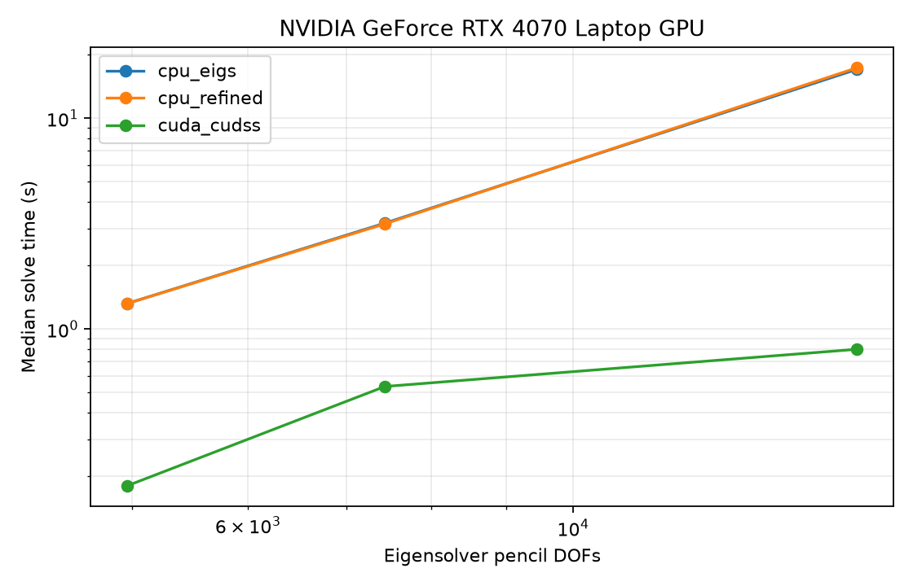

# RTX 4070 Laptop: dielectric-rod antenna pencil

Measured 13 October 2026 using complex FP64, four eigenpairs, `ncv=80`, and
original-pencil tolerance `1e-8`. CPU BLAS threads: one. Median of three warm
runs; assembly and warmup excluded, GPU transfer and cuDSS factorization
included. This compares the eigenproblem stage before the FEM mode filters.

| FEM DOFs | Pencil DOFs | CPU eigs (s) | CPU refined (s) | CUDA/cuDSS (s) | Speedup vs eigs |
|---:|---:|---:|---:|---:|---:|
| 2,481 | 4,962 | 1.323 | 1.321 | 0.181 | 7.3x |
| 3,720 | 7,440 | 3.181 | 3.156 | 0.534 | 6.0x |
| 7,814 | 15,628 | 17.072 | 17.367 | 0.802 | 21.3x |

All results converged, matched CPU ARPACK eigenvalues, and had GPU physical
residuals below `6e-13`. A separate full 3D FEM solve at 5,067 reduced FEM
DOFs returned the CPU's two forward leaky modes, including the Gauss and
PML filters: `0.28751661-0.09682371j`, `0.21839032-0.05854464j`.

[CSV](results.csv), [hardware and options](results.json),
[setup and methodology](../../periodic_eigensolver/README.md).

