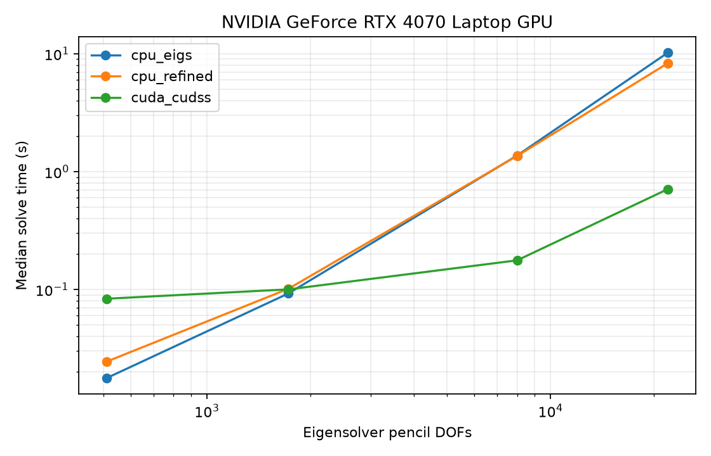

# RTX 4070 Laptop: 3D nonsymmetric stencil pencil

Measured 13 October 2026 using complex FP64, four eigenpairs, `ncv=64`, and
original-pencil tolerance `1e-8`. CPU BLAS threads: one. Median of three warm
runs; assembly and warmup excluded, GPU transfer and cuDSS factorization
included. B is nonidentity; A is complex and nonsymmetric.

| Pencil DOFs | CPU eigs (s) | CPU refined (s) | CUDA/cuDSS (s) | Speedup vs eigs |
|---:|---:|---:|---:|---:|
| 512 | 0.0178 | 0.0245 | 0.0836 | 0.21x |
| 1,728 | 0.0926 | 0.1015 | 0.1003 | 0.92x |
| 8,000 | 1.369 | 1.359 | 0.177 | 7.7x |
| 21,952 | 10.195 | 8.297 | 0.710 | 14.4x |

All results converged and matched CPU ARPACK eigenvalues. GPU residuals
were below `2e-14`. GPU overhead dominates small problems; CUDA/cuDSS becomes
faster on the larger pencils. These timings are
measurements on this laptop, not performance guarantees for other hardware.

[CSV](results.csv), [hardware, options, and timing samples](results.json),
[setup and methodology](../../periodic_eigensolver/README.md).

