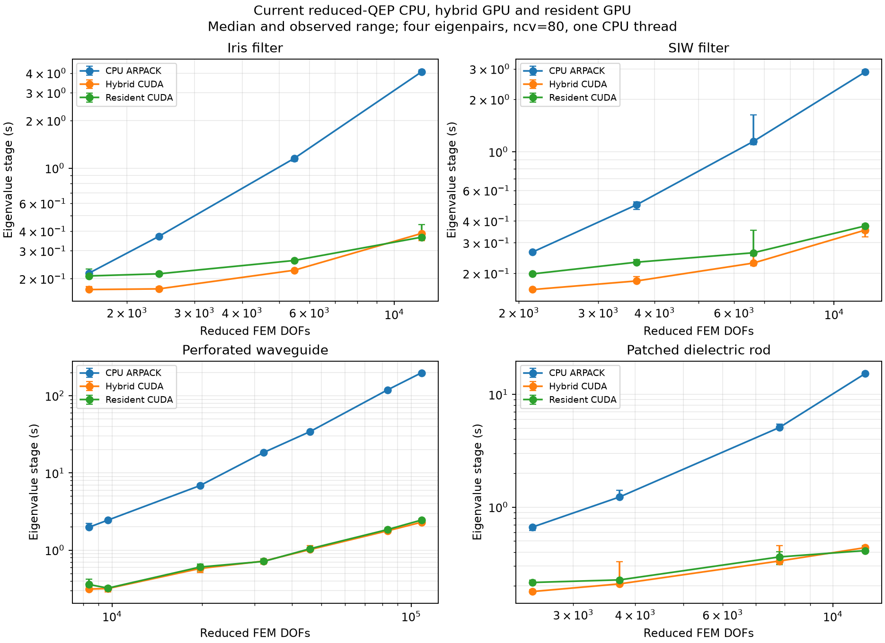
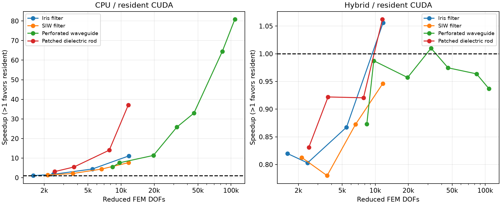

Resident GPU comparison — 2026-10-16
===================================

Source main commit: 5bd9fd1ef46da5c025d820955474333978acf288. 19 configurations, 171 timed solves; all validated.
Maximum QEP residual: 2.834e-13; maximum magnitude mismatch: 5.215e-14.

Resident iteration diagnostics: steps [80], cycles [1]. This sweep measures matrix-size scaling, not difficult multi-restart convergence.

Hardware and software
---------------------

Two Intel Xeon Silver 4210 CPUs at 2.20 GHz, 20 physical cores / 40 logical threads; 109.28 GiB OS-visible RAM.
One NVIDIA TITAN RTX (physical GPU 3, 24 GiB VRAM), NVIDIA driver 595.45.04, CUDA runtime 13.2.
NumPy 2.5.4, SciPy 1.18.1, CuPy 14.2.0, cuDSS 0.8.0.10. BLAS thread limit one, verified at runtime.
Full topology, installed package versions, GPU/load snapshots, commands and source hashes are in metadata.json. Shared host; timings include background variability.

When sweeps are combined, source_metadata_*.json retains each original run. Mesh densities were measured sequentially; small differences between GPU medians should not be treated as statistically established improvements.

Method
------

Same physical unit cells as the October 13 benchmark; mesh targets and actual DOFs are recorded for each case. Four eigenpairs, ncv=80, tolerance 1e-8, seed 0; fresh reduced Q(shift) factorization each solve.
One excluded warmup/backend/case; three timed repeats with rotated backend order. Assembly is excluded. Transfers, readiness checks, factorization, iteration and eigenpair export are included.
Both GPU paths perform the same readiness checks. Hybrid uses the retained iterate_hybrid control and exports full companion eigenvectors; resident exports the physical block. The production numerical implementations are unchanged.
Host QEP validation runs after timing for every backend. GPU paths additionally perform their production QEP residual checks inside iteration; CPU ARPACK does not include that extra physical-residual pass in its stage timing.
One-to-one eigenvalue-magnitude agreement accepts symmetry partners. These timings precede physical mode filtering, reconstruction and adaptive estimation; they are not complete public-solve timings.
The old benchmark factored a 2n companion pencil. Current CPU and GPU paths factor n-dimensional Q(shift), so ratios from the earlier report cannot isolate the kernel change. This paired hybrid/resident comparison uses the same reduced operator.

Historical CPU timing also used ARPACK tolerance 1e-10 and included external residual evaluation; current CPU uses 1e-8 with independent host validation outside timing. Therefore old/new CPU speedups are not a controlled factorization-only experiment. Saved CPU root magnitudes across the 16 original meshes agree within 4.3e-14 (historical_root_comparison.json).

Results
-------

.. csv-table::
   :header: "Case", "FEM DOFs", "CPU s", "Hybrid GPU s", "Resident GPU s", "CPU/resident", "Hybrid/resident"

   "iris-coarse", 1591, 0.2165, 0.1704, 0.2079, 1.04, 0.82
   "iris-medium", 2422, 0.3699, 0.1721, 0.2144, 1.73, 0.80
   "iris-fine", 5477, 1.1543, 0.2259, 0.2604, 4.43, 0.87
   "iris-large", 11782, 4.0708, 0.3862, 0.3656, 11.13, 1.06
   "siw-coarse", 2145, 0.2651, 0.1613, 0.1984, 1.34, 0.81
   "siw-medium", 3646, 0.4955, 0.1807, 0.2317, 2.14, 0.78
   "siw-fine", 6623, 1.1479, 0.2291, 0.2626, 4.37, 0.87
   "siw-large", 11711, 2.8764, 0.3544, 0.3745, 7.68, 0.95
   "perforated_waveguide-coarse", 8373, 1.9818, 0.3132, 0.3588, 5.52, 0.87
   "perforated_waveguide-medium", 9685, 2.4492, 0.3179, 0.3220, 7.61, 0.99
   "perforated_waveguide-fine", 19680, 6.8596, 0.5780, 0.6039, 11.36, 0.96
   "perforated_waveguide-large", 32161, 18.4504, 0.7215, 0.7144, 25.83, 1.01
   "dielectric_rod-coarse", 2484, 0.6657, 0.1785, 0.2149, 3.10, 0.83
   "dielectric_rod-medium", 3720, 1.2310, 0.2088, 0.2264, 5.44, 0.92
   "dielectric_rod-fine", 7807, 5.0840, 0.3331, 0.3619, 14.05, 0.92
   "dielectric_rod-large", 11609, 15.2356, 0.4372, 0.4116, 37.02, 1.06
   "perforated_waveguide-xl", 45926, 34.3565, 1.0168, 1.0432, 32.93, 0.97
   "perforated_waveguide-xxl", 83298, 118.9676, 1.7782, 1.8451, 64.48, 0.96
   "perforated_waveguide-100k", 108261, 198.4205, 2.2985, 2.4536, 80.87, 0.94

Interpretation
--------------

* Iris filter at 11,782 FEM DOFs: resident speedup 11.13x versus CPU and 1.06x versus hybrid GPU.
* SIW filter at 11,711 FEM DOFs: resident speedup 7.68x versus CPU and 0.95x versus hybrid GPU.
* Patched dielectric rod at 11,609 FEM DOFs: resident speedup 37.02x versus CPU and 1.06x versus hybrid GPU.
* Perforated waveguide at 108,261 FEM DOFs: resident speedup 80.87x versus CPU and 0.94x versus hybrid GPU.

A ratio below one means the resident path is slower. Device residency by itself does not guarantee a speedup, particularly for small projected dense problems.
With ncv=80, the projected dense eigensystem stays about 80-by-80 even as FEM DOFs grow. Hybrid already performs sparse factorization/solves on GPU and handles this small Ritz problem on CPU. Resident moves Ritz eigensolving/SVD to CUDA and launches conditional breakdown-handling kernels plus a second norm each Arnoldi step. These implementation differences are plausible overhead sources; this benchmark does not separately profile their costs.
Every resident sample records CUDA geev/SVD execution, operator steps/cycles and two explicit application control bytes per cycle. Vendor-library internal workspace/control transfers are outside that count.

Files: comparison.csv, summary.csv/json, audit.json, metadata.json, and per-case results.json including first/warmup timings, all complex eigenvalues and residuals.
