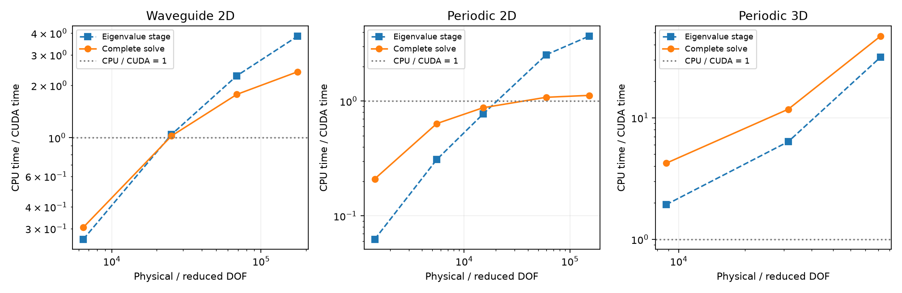

FEM CUDA versus SciPy benchmark
===============================

Measured on 16 October 2026 using FEM 2.0.1. This page is the
current RTX 4070 Laptop / i9 reference for the resident CUDA implementation.
It supersedes earlier local CPU/GPU laptop performance reports. Historical
Titan RTX measurements and hybrid-versus-resident controls are separate experiments.

Backend policy update: these recorded measurements explicitly selected the
resident GPU path. They remain reproducible with ``gpu`` (FDFD also accepts
``cuda``). Current ``auto`` selects hybrid GPU Arnoldi/CPU Ritz, then warns
before CPU fallback; the timing snapshots below are unchanged.

Machine and software
--------------------

* NVIDIA GeForce RTX 4070 Laptop GPU, 8 GB; Intel Core i9-13900H.
* Windows 11, Performance power scheme; CPU BLAS/OpenMP limited to one thread.
  Both loaded OpenBLAS libraries reported one thread.
* Python 3.12.14, NumPy 2.5.3, SciPy 1.18.1,
  CuPy 14.2.0, CUDA runtime 13.2, cuDSS 0.8.0.10.
* Numerical source commits: FEM ``29609315da77``;
  FDFD ``ca2d5f442847``.

CUDA installation remains completely optional. The standard installation supports
CPU solving; the optional CUDA extras enable the accelerated path.

Measurement protocol
--------------------

One forward mode is requested at eigensolver tolerance ``1e-9``. CPU uses
SciPy ARPACK ``eigs`` with SuperLU shift-invert; CUDA uses custom complex-FP64
resident refined Arnoldi, cuDSS sparse factorization/solves and CUDA Ritz
eigensolving/SVD. Each backend solves the same mesh and material model.

Each configuration receives one untimed solve per backend, followed by three
measured repeats in alternating CPU/GPU order. Tables report median wall times;
CUDA streams are synchronized at timer boundaries. Every solve performs a fresh
factorization. Warm FEM 3D solves reuse static resident geometry. Runtime probes
and compiler caches are warmed globally. Adaptive refinement is disabled.

Waveguides and FEM periodic 2D retain production Krylov defaults. FDFD periodic
2D and FEM periodic 3D use ``ncv=96`` on both backends. FEM physical filters request
extra eigenpairs; GPU refined Arnoldi and CPU ARPACK perform different extraction
and convergence work. These are measurements of the current public implementations.

The **eigenvalue stage** includes sparse factorization, iteration, dense Ritz work
and final eigenpair export. FDFD also includes its original-pencil backward-error
check. The resident FEM 3D timer includes its polynomial residual check; CPU FEM
physical residual filters run outside this timer.

The **complete solve** measures a premeshed ``solver.solve`` call, including
physical filtering, field reconstruction/normalization, error estimation and
result export. FDFD also rebuilds modal matrices inside each public call. Meshing
is excluded from these warmed timings. GPU times include runtime setup performed
inside the solve and required transfers. Speedup is CPU seconds / CUDA seconds;
values below one favor CPU.

The plot shows PEC reference cases; the tables include every measured material case.

Waveguide 2D
------------

.. list-table:: Median times and speedups
   :header-rows: 1

   * - Case
     - DOF
     - Eigen CPU / CUDA (s)
     - Eigen speedup
     - Complete CPU / CUDA (s)
     - Complete speedup
   * - ``pec``
     - 6,447
     - 0.333 / 1.280
     - 0.26x
     - 0.424 / 1.391
     - 0.30x
   * - ``pec``
     - 25,099
     - 1.574 / 1.510
     - 1.04x
     - 1.966 / 1.922
     - 1.02x
   * - ``pec``
     - 68,827
     - 5.468 / 2.406
     - 2.27x
     - 6.719 / 3.785
     - 1.78x
   * - ``pec``
     - 176,051
     - 16.736 / 4.355
     - 3.84x
     - 19.986 / 8.338
     - 2.40x
   * - ``pec_lossy``
     - 25,099
     - 2.078 / 1.620
     - 1.28x
     - 2.483 / 2.091
     - 1.19x
   * - ``pec_lossy``
     - 68,827
     - 6.781 / 2.353
     - 2.88x
     - 8.029 / 3.665
     - 2.19x
   * - ``pec_sibc_lossy``
     - 24,270
     - 1.595 / 1.621
     - 0.98x
     - 1.974 / 2.079
     - 0.95x
   * - ``pec_sibc_lossy``
     - 66,766
     - 5.247 / 2.317
     - 2.26x
     - 6.448 / 3.599
     - 1.79x

Periodic 2D
-----------

.. list-table:: Median times and speedups
   :header-rows: 1

   * - Case
     - DOF
     - Eigen CPU / CUDA (s)
     - Eigen speedup
     - Complete CPU / CUDA (s)
     - Complete speedup
   * - ``pec``
     - 1,428
     - 0.025 / 0.402
     - 0.06x
     - 0.109 / 0.519
     - 0.21x
   * - ``pec``
     - 5,506
     - 0.122 / 0.394
     - 0.31x
     - 0.522 / 0.820
     - 0.64x
   * - ``pec``
     - 15,083
     - 0.467 / 0.607
     - 0.77x
     - 2.013 / 2.301
     - 0.87x
   * - ``pec``
     - 59,701
     - 2.539 / 1.003
     - 2.53x
     - 12.358 / 11.447
     - 1.08x
   * - ``pec``
     - 152,058
     - 7.727 / 2.099
     - 3.68x
     - 52.117 / 46.475
     - 1.12x
   * - ``dielectric_insert``
     - 74,585
     - 3.200 / 1.142
     - 2.80x
     - 16.472 / 14.961
     - 1.10x
   * - ``pec_lossy``
     - 5,506
     - 0.117 / 0.401
     - 0.29x
     - 0.511 / 0.825
     - 0.62x
   * - ``pec_lossy``
     - 15,083
     - 0.454 / 0.568
     - 0.80x
     - 2.010 / 2.226
     - 0.90x

Periodic 3D
-----------

.. list-table:: Median times and speedups
   :header-rows: 1

   * - Case
     - DOF
     - Eigen CPU / CUDA (s)
     - Eigen speedup
     - Complete CPU / CUDA (s)
     - Complete speedup
   * - ``iris_pec``
     - 8,774
     - 1.001 / 0.519
     - 1.93x
     - 3.019 / 0.715
     - 4.22x
   * - ``iris_pec``
     - 31,353
     - 7.764 / 1.222
     - 6.35x
     - 21.740 / 1.851
     - 11.75x
   * - ``iris_pec``
     - 82,081
     - 68.179 / 2.165
     - 31.48x
     - 151.933 / 3.240
     - 46.90x
   * - ``iris_lossy``
     - 31,353
     - 7.726 / 1.211
     - 6.38x
     - 21.539 / 2.158
     - 9.98x

Cases and DOF
-------------

Waveguides use a 1 m by 0.5 m PEC enclosure at 299.792458 MHz. ``pec``
is vacuum; ``pec_lossy`` uses relative permittivity ``2 - 0.02j``.
``pec_sibc_lossy`` adds an internal rectangle at x = 0.56--0.68 m,
y = 0.11--0.23 m, with surface impedance ``20 + 20j`` ohm in the lossy fill.
Meshes use first-order elements and uniform sizing controls.

Periodic 2D uses a 20 mm by 10 mm (x, z) cell at 10 GHz, PEC x boundaries,
and TE polarization. ``pec`` and ``pec_lossy`` use the same fills as above.
``dielectric_insert`` has vacuum background and an insert at x = 6--14 mm,
z = 4--6 mm with relative permittivity ``4 - 0.04j``.

Periodic 3D uses a WR-90 PEC enclosure (22.86 by 10.16 mm), an 8 mm
period and 12 GHz. Two PEC iris blocks span x = 0--4 mm and 18.86--22.86 mm,
the full height, and z = 3.6--4.4 mm. Target tetrahedral sizes are 1.6, 0.9 and
0.6 mm; actual reduced DOF are reported. ``iris_lossy`` fills the air region
with relative permittivity ``2 - 0.02j``.

FEM tables report physical DOF. The quadratic companion eigenproblem has twice
that dimension; only the physical-size polynomial is factorized.

First result on a new mesh
--------------------------

These single first-solve samples include initial resident geometry preparation.
CUDA runtime and compiler caches are already warm. The last column includes the
same measured meshing/assembly cost plus each backend's first public solve;
it therefore includes GPU geometry preparation as well as meshing.

.. list-table:: FEM 3D first-solve timings
   :header-rows: 1

   * - Case / DOF
     - CPU first solve (s)
     - CUDA first solve (s)
     - First-solve speedup
     - Mesh + first solve speedup
   * - iris_pec / 8,774
     - 2.945
     - 1.275
     - 2.31x
     - 1.76x
   * - iris_pec / 31,353
     - 21.640
     - 3.614
     - 5.99x
     - 3.66x
   * - iris_pec / 82,081
     - 148.038
     - 6.598
     - 22.44x
     - 10.67x
   * - iris_lossy / 31,353
     - 21.083
     - 3.600
     - 5.86x
     - 3.60x

Interpretation
--------------

The largest waveguide achieves 3.84x eigenvalue-stage and 2.40x complete-solve
speedup. Periodic 2D reaches 3.68x in the eigenvalue stage but 1.12x overall;
host field reconstruction and error estimation dominate its remaining runtime.
The dielectric-insert cell similarly gives 2.80x eigenvalue-stage and 1.10x overall.

The 82,081-DOF iris reaches 31.48x in the eigenvalue stage and 46.90x for warmed
complete solves. Its first solve per mesh gives 22.44x; meshing through first
result gives 10.67x. The complete-solve gain includes the resident physical
filters, fields and estimator, together with prepared static geometry reuse.
Small waveguide and periodic 2D meshes favor CPU.

Numerical checks and recorded data
----------------------------------

All 20 FEM configurations passed, with 120 measured warmed solves
and 40 first-solve samples. CPU/GPU mode sets are matched by effective-index
distance and must agree within ``1e-6`` relative error. Every returned-mode
residual must be at most ``1e-8``. The measured maximum relative mode difference
is ``1.182e-12``; the maximum residual is ``1.911e-11``.
The joint FEM/FDFD run contains 33 configurations and 198 warmed samples.

* `Summary CSV <../_static/benchmarks/cuda_vs_scipy_20261016/summary.csv>`_
* `All timings, first solves, residuals and effective indices <../_static/benchmarks/cuda_vs_scipy_20261016/results.json>`_
* `Machine, software, source commits and thread-pool record <../_static/benchmarks/cuda_vs_scipy_20261016/environment.json>`_
* `Verification summary <../_static/benchmarks/cuda_vs_scipy_20261016/verification.json>`_
* `SHA-256 checksums <../_static/benchmarks/cuda_vs_scipy_20261016/SHA256SUMS.txt>`_

Reproduction
------------

The shared harness lives in the FEM repository and reads the sibling FDFD
source checkout. Clone FEM and FDFD side by side, then run from FEM using a
CUDA-capable Python environment. The optional ``threadpoolctl`` dependency is
used by the benchmark to verify single-thread CPU execution.

.. code-block:: powershell

   python -m pip install -e ".[cuda13]" -e "../FDFD" threadpoolctl
   python benchmarks/cuda_vs_scipy.py --output outputs/benchmarks/cuda_vs_scipy_reproduction
   python benchmarks/report_cuda_vs_scipy.py outputs/benchmarks/cuda_vs_scipy_reproduction

Use ``cuda12`` instead when matching a CUDA 12 environment with the required
CUDA Ritz support. ``--ids`` selects individual cases listed by
``configurations()``. Completed cases are skipped on resume; use a new output
directory for a fresh measurement. Run GPU jobs sequentially on an idle machine.

`Benchmark harness <https://github.com/SolverNotConverging/Electromagnetics-FEM/blob/main/benchmarks/cuda_vs_scipy.py>`_
and `report generator <https://github.com/SolverNotConverging/Electromagnetics-FEM/blob/main/benchmarks/report_cuda_vs_scipy.py>`_
are committed with these results. Recorded timings describe this laptop,
mode count and solver settings; Titan RTX results remain a separate hardware comparison.
